<div align="center">

<a href="https://ronin.xaviermsd.workers.dev/">
  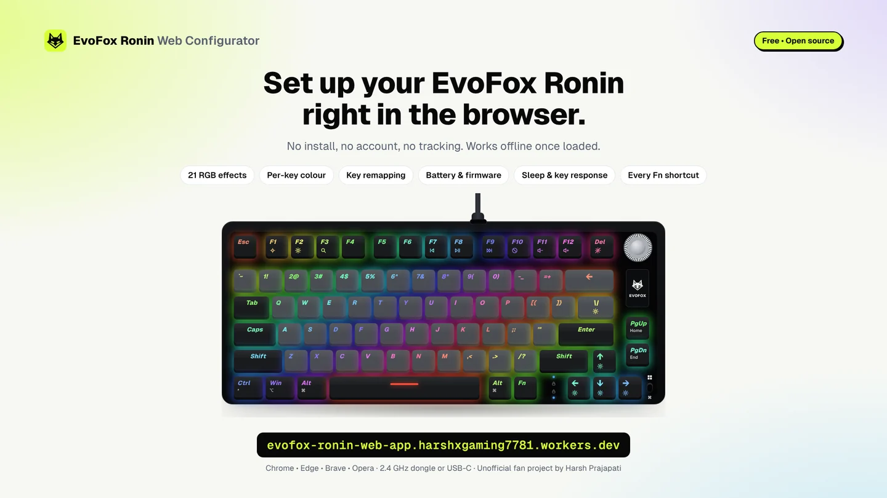
</a>

# EvoFox Ronin Web Configurator

**Set up your Amkette EvoFox Ronin 75% Wireless right in the browser.**<br>
No install, no account, no tracking. Works offline once loaded.

<sub>Unofficial fan project. Not affiliated with, endorsed by or sponsored by Amkette or EvoFox. EvoFox and Ronin are trademarks of their owners.</sub>

[](https://ronin.xaviermsd.workers.dev/)
[](https://wicg.github.io/webhid/)
[](package.json)
[](LICENSE)

[Features](#features) · [Design](#designed-as-one-product) · [Quick start](#quick-start) · [Keyboard shortcuts](#keyboard-shortcuts) · [Privacy](#privacy-and-safety) · [How it works](#how-it-works) · [FAQ](#faq)

</div>

---

## Plug in and it just works

<div align="center">
  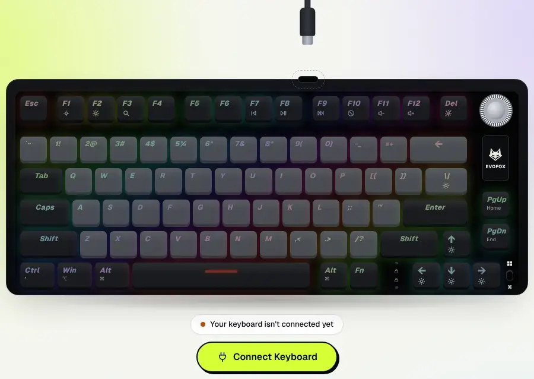
</div>

Click **Connect Keyboard**, pick your Ronin in the browser prompt, and the app takes it from there:

- **It knows your keyboard.** The drawing is the real Ronin: black and grey keycaps with shine-through legends, the silver volume knob, the EVOFOX plate, PgUp/PgDn, the lock lights and the Type-C port on the top edge, laid out exactly as in the official quick start guide.
- **It stays calm.** Nothing moves while you wait. The cable plugs in once, the keys light up once, and that's it.
- **It tells you what's happening.** Unplug the cable or receiver and you get a soft amber notice. Plug it back in and it reconnects by itself.
- **It survives a reload.** Refresh the page and it reconnects to the cable or receiver you used last, without touching your keyboard's lighting.
- **It opens with a short branded splash** (the fox in a lime ring, about a second) and then gets out of the way. Nothing else in the app is slowed down on purpose.

---

## Why this exists

The official EvoFox software runs from a cloud web page, every change needs another click on **Upload**, and there's no full guide to the Fn shortcuts. This app is a free, private alternative that talks to the keyboard directly from your browser.

| | Official cloud software | This app |
| :--- | :---: | :---: |
| **Where it runs** | Cloud web page | **Your browser, fully offline after loading** |
| **Tracking** | Unknown | **None. No account, no analytics** |
| **Applying changes** | Click Upload every time | **Live Sync as you move a slider** |
| **Preview** | Basic | **Live preview on an accurate Ronin** |
| **Fn shortcuts guide** | Not included | **Every shortcut, searchable, works on phones** |
| **After a page reload** | Start over | **Reconnects and remembers your settings** |
| **Wrong device picked** | Silent failure | **Clear warning, nothing is sent** |

---

## Features

### Live RGB lighting

<div align="center">
  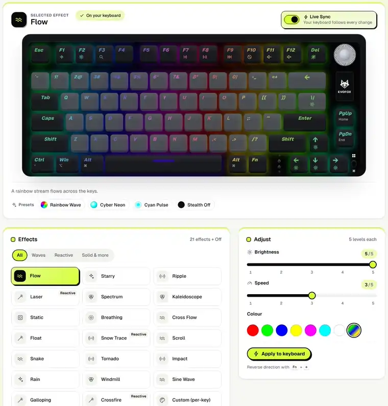
</div>

- **All 21 effects plus Off:** Flow, Starry, Ripple, Laser, Spectrum, Kaleidoscope, Static, Breathing, Cross Flow, Float, Snow Trace, Scroll, Snake, Tornado, Impact, Rain, Windmill, Sine Wave, Galloping, Crossfire, and Custom (per-key).
- **Only the controls each effect supports** are shown, straight from the official driver: brightness and speed (5 levels each), one of the keyboard's colours (red, green, blue, yellow, magenta, cyan, white or multicolour), or one of 8 two-colour gradients for *Float*.
- **Live Sync:** your keyboard follows the sliders as you move them. Turn it off to preview first and apply with one click.
- **Reactive effects** (Ripple, Laser and others) react when you click keys on screen, just like pressing them.
- **Quick presets:** Rainbow Wave, Cyber Neon, Cyan Pulse, Stealth Off.

### Per-key colour

<div align="center">
  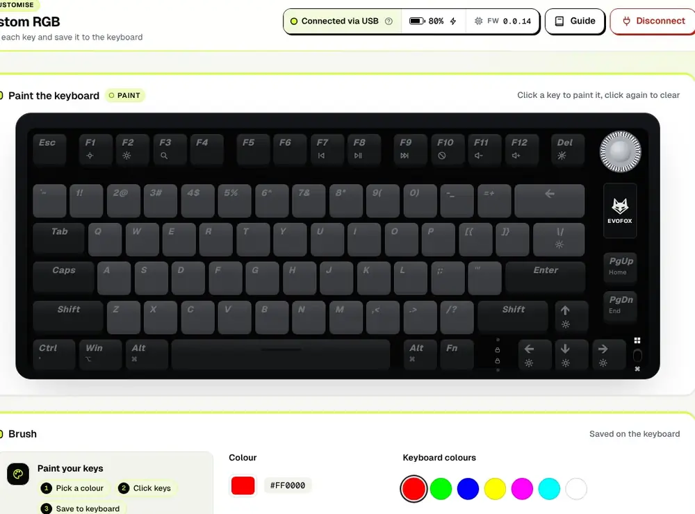
</div>

- Pick one of the keyboard's colours, or any colour with the picker, and click keys to paint them.
- Works like the official software: unpainted keys stay off, and clicking a key again with the same colour turns it off.
- **Fill All Keys**, **Undo** (also <kbd>Ctrl</kbd> + <kbd>Z</kbd>), then **Save to Keyboard**. The colours live on the keyboard, even when it's unplugged.

### Key remapping

<div align="center">
  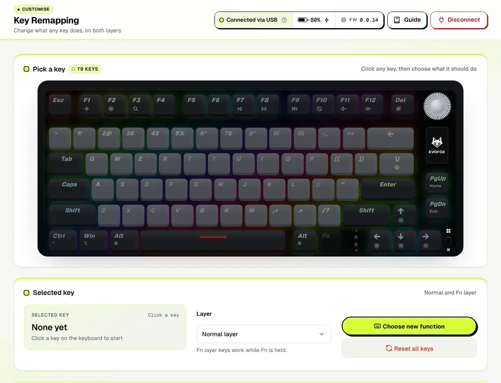
</div>

- Click a key on the drawing, pick the **layer** (normal, or Fn while held) and choose what it should do: letters, numbers, F-keys, media keys, navigation and more.
- Keys the firmware needs for its own shortcuts are locked, so you can't break pairing or reset by accident.
- **Reset All Keys** puts everything back.

### Settings, battery and profiles

<table>
  <tr>
    <td width="50%">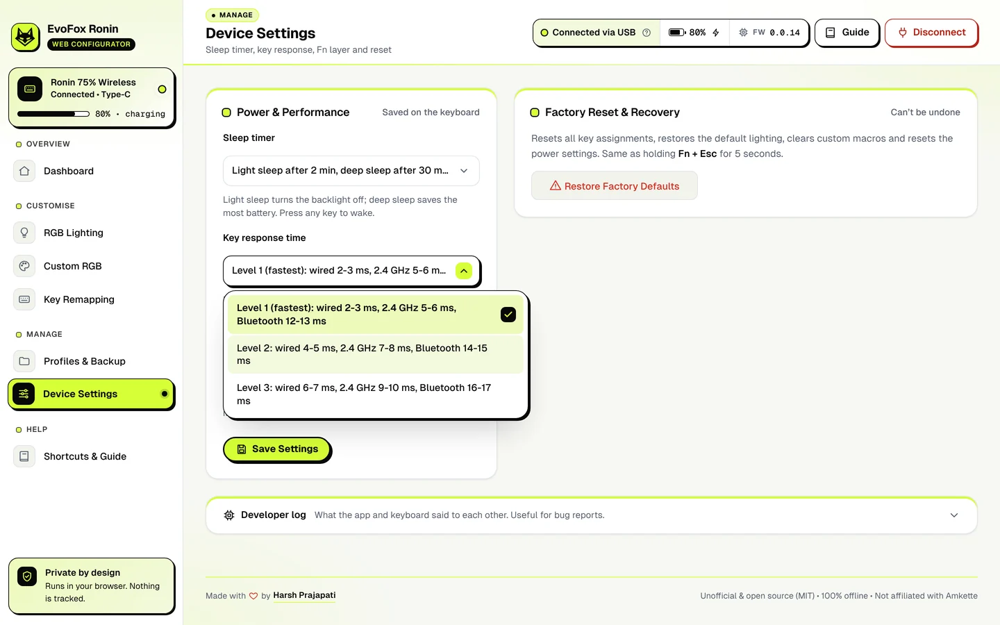</td>
    <td width="50%">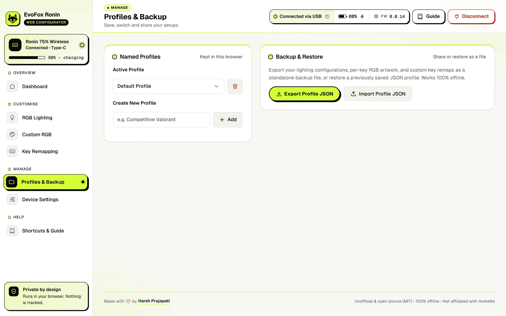</td>
  </tr>
  <tr>
    <td>
      <b>Device settings</b><br>
      Sleep timer (2 / 15 / 30 min, or never), key response time (Level 1 is fastest: 2–3 ms wired), Fn layer mode (hold or press once) and factory reset. Every option is a branded dropdown that works with mouse, keyboard and screen readers.
    </td>
    <td>
      <b>Profiles and backup</b><br>
      Save as many profiles as you like in your browser, switch between them, and export or import them as JSON files. Drag a file onto the app to import it.
    </td>
  </tr>
</table>

The dashboard shows **battery level, charging, connection type and firmware version**, refreshed automatically.

<div align="center">
  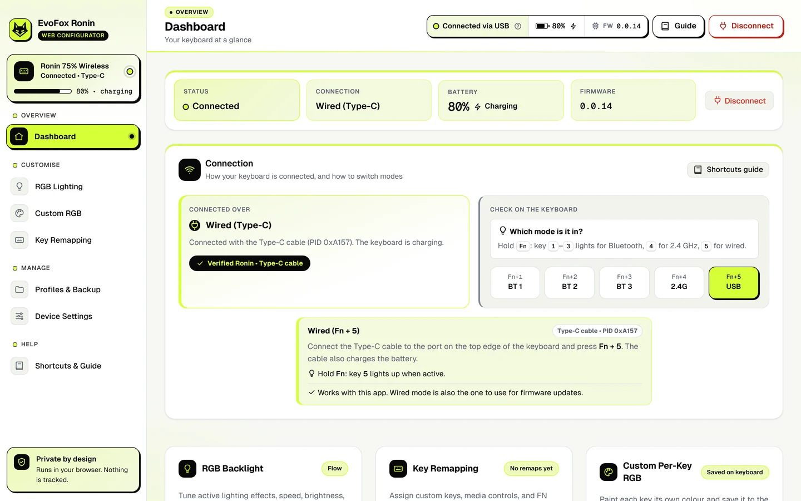
</div>

### Shortcuts guide, on any screen

<table>
  <tr>
    <td width="58%">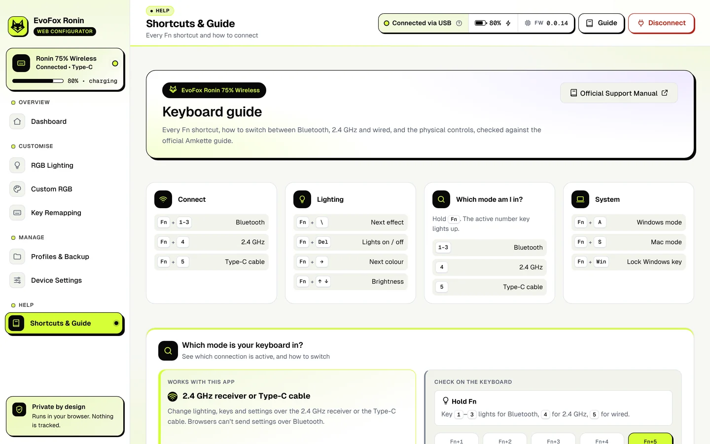</td>
    <td width="42%">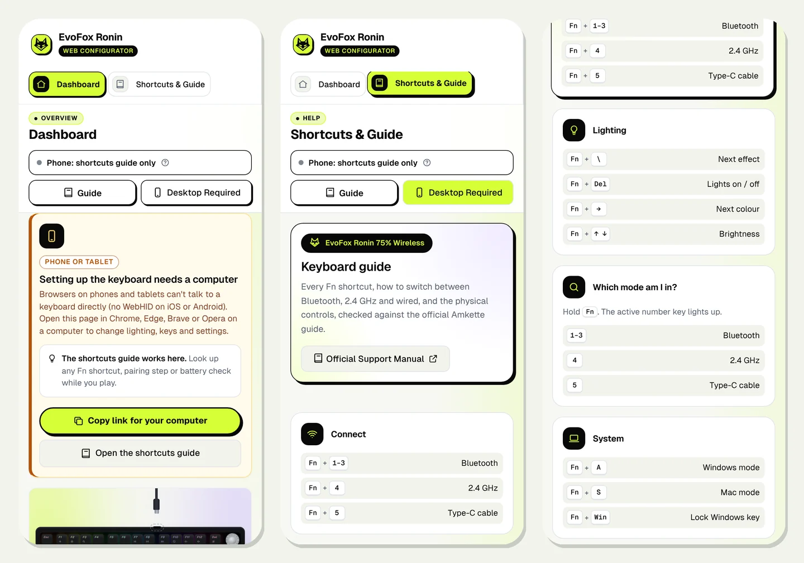</td>
  </tr>
</table>

Every Fn shortcut and physical control from the official quick start guide, searchable. Phones can't configure the keyboard (no WebHID on mobile), but the guide works there, so you can look up a shortcut mid-game.

<details>
<summary><b>More screens</b> (click to open)</summary>
<br>

| Welcome | RGB Lighting |
| :---: | :---: |
| 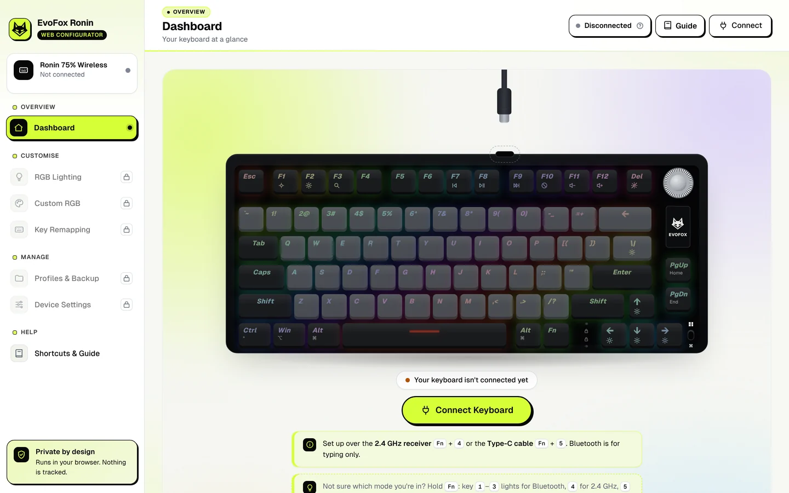 | 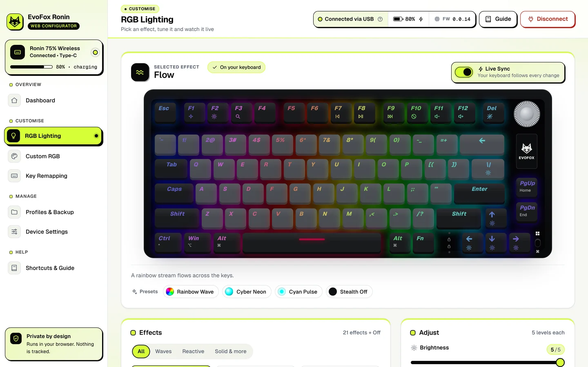 |
| **Key Remapping** | **Custom RGB** |
| 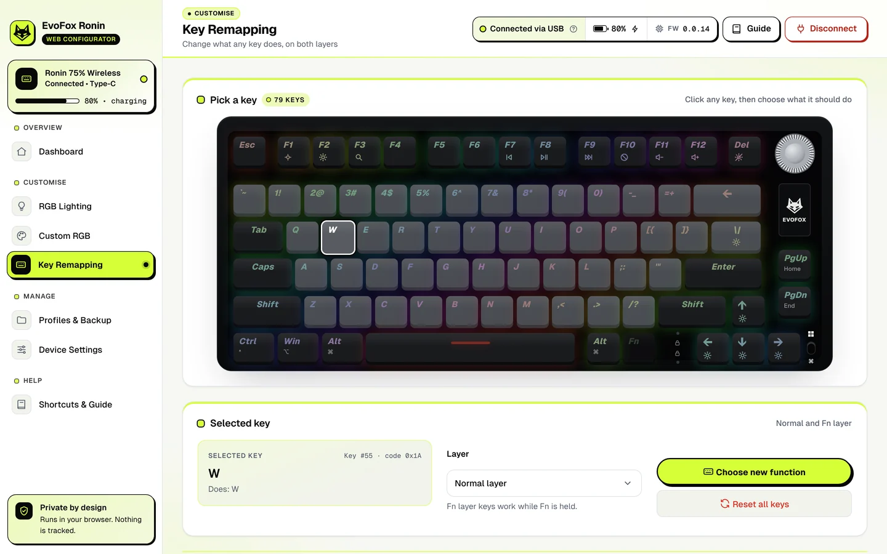 | 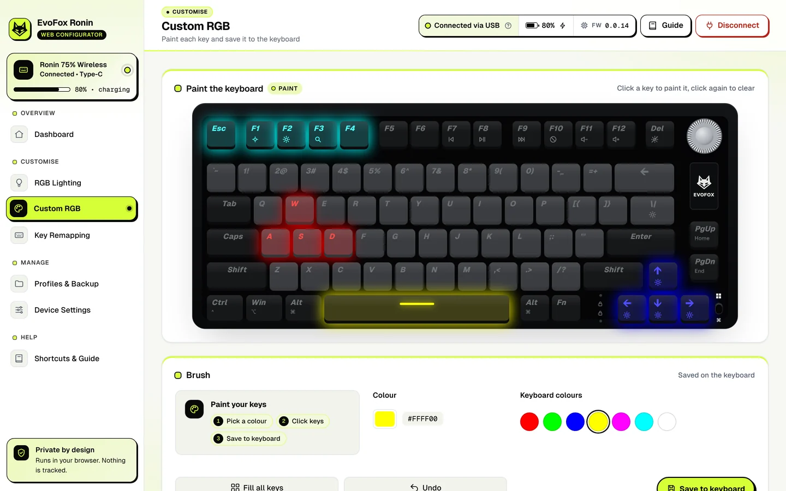 |

</details>

---

## Designed as one product

Every screen, button, notice and menu comes from one small design system, so the app feels like a single product rather than a set of pages.

| | |
| :--- | :--- |
| **Colour** | Four brand colours: Electric Lime `#D6FF36`, Ink `#080808`, Warm White `#F7F8F4`, Slate `#58616F`. Lime marks what's active or successful, ink carries text and borders, and amber and red are kept only for warnings and errors. All colours live in one file (`src/tokens.css`); text contrast is at least 5.4 : 1. |
| **Type** | Geist and Geist Mono, bundled with the app (no font CDN). |
| **Signature style** | Ink borders and a hard offset shadow on primary buttons, the active sidebar item, open dropdowns and toasts. |
| **Loading and feedback** | One shared system: a first-load splash; buttons that switch to *Connecting…*, *Applying…* or *Saving…* and ignore double clicks; a small overlay on just the card that's busy; a full-screen loader only for connecting and factory reset. Toasts appear only after the keyboard has really confirmed success or failure. |
| **Dropdowns** | Custom lime-branded menus instead of the browser's default ones: animated, with a check on the chosen option, type-ahead, full arrow-key support and proper screen-reader labels. |
| **Motion** | Short, purposeful transitions. With *reduce motion* turned on in your system settings, animations slow down or stop. |
| **Accessibility** | Every control is reachable by keyboard with a visible focus ring; labels and live status are announced to screen readers. |

---

## Quick start

1. Open **[the app](https://ronin.xaviermsd.workers.dev/)** in **Chrome, Edge, Brave or Opera** on a computer.
2. Connect the keyboard one of two ways:
   - **2.4 GHz:** take the receiver out of its slot on the keyboard, plug it into your computer, press <kbd>Fn</kbd> + <kbd>4</kbd>.
   - **Wired:** plug in the Type-C cable and press <kbd>Fn</kbd> + <kbd>5</kbd>.
3. Click **Connect Keyboard** and choose *2.4 Wireless Device* or *EvoFox Ronin* in the prompt.

> [!NOTE]
> **Bluetooth can't be used for setup.** Operating systems don't let browsers send settings to a keyboard over Bluetooth. Switch to 2.4 GHz or wired, change your settings, then switch back. Your settings stay on the keyboard.

> [!TIP]
> **Not sure which mode you're in?** Hold <kbd>Fn</kbd> on its own: key <kbd>1</kbd>–<kbd>3</kbd> (Bluetooth), <kbd>4</kbd> (2.4 GHz) or <kbd>5</kbd> (wired) lights up.

| Browser | Works? |
| :--- | :---: |
| Google Chrome, Microsoft Edge, Brave, Opera / Opera GX (desktop) | ✅ |
| Firefox, Safari | ❌ No WebHID support |
| Phones and tablets | Guide only |

<details>
<summary><b>Run it on your own computer</b></summary>
<br>

No build step and no packages to install:

```bash
npm start        # or: node server.js
```

It opens **http://localhost:3000**. WebHID needs `localhost` or HTTPS, which this server provides.

On **Linux**, if Chrome can't open the keyboard, add a udev rule for `ATTRS{idVendor}=="1a2c"` and replug it.

</details>

---

## Keyboard shortcuts

From the official **Amkette EvoFox Ronin Wireless quick start guide**.

### Connection

| Shortcut | What it does |
| :--- | :--- |
| <kbd>Fn</kbd> + <kbd>1</kbd> / <kbd>2</kbd> / <kbd>3</kbd> | Bluetooth slot 1 / 2 / 3. **Hold 3–5 s** to pair (the key blinks fast). |
| <kbd>Fn</kbd> + <kbd>4</kbd> | 2.4 GHz wireless. **Hold** if the receiver needs re-pairing (LED blinks fast). |
| <kbd>Fn</kbd> + <kbd>5</kbd> | Wired (Type-C). The cable also charges the battery. |

### Lighting

| Shortcut | What it does |
| :--- | :--- |
| <kbd>Fn</kbd> + <kbd>\\</kbd> | Next lighting effect |
| <kbd>Fn</kbd> + <kbd>Del</kbd> | Backlight off / on |
| <kbd>Fn</kbd> + <kbd>→</kbd> | Next colour |
| <kbd>Fn</kbd> + <kbd>←</kbd> | Effect direction |
| <kbd>Fn</kbd> + <kbd>↑</kbd> / <kbd>↓</kbd> | Brightness up / down |
| <kbd>Fn</kbd> + <kbd>−</kbd> / <kbd>=</kbd> | Effect speed (as printed in the guide) |

### System

| Shortcut | What it does |
| :--- | :--- |
| <kbd>Fn</kbd> + <kbd>A</kbd> | Windows mode (media keys need Fn; F4 is Copilot) |
| <kbd>Fn</kbd> + <kbd>S</kbd> | Mac mode (media keys work without Fn; Ctrl = ⌃, Win = ⌥, Alt = ⌘) |
| <kbd>Fn</kbd> + <kbd>Win</kbd> | Lock the Windows key (the lock light next to the arrows turns on) |
| <kbd>Fn</kbd> + <kbd>Esc</kbd> (hold 5 s) | Factory reset |
| <kbd>Fn</kbd> + <kbd>Backspace</kbd> | Battery level on the number keys |

<details>
<summary><b>Media keys, volume knob and hardware</b></summary>
<br>

- **F-row media** (Windows: hold <kbd>Fn</kbd>; Mac: press alone): **F1/F2** screen brightness, **F3** search, **F4** Copilot, **F7** previous, **F8** play/pause, **F9** next, **F10** mute, **F11/F12** volume down/up.
- <kbd>Fn</kbd> + <kbd>PgUp</kbd> = Home, <kbd>Fn</kbd> + <kbd>PgDn</kbd> = End.
- **Volume knob:** turn for volume, press to mute.
- **Lock lights:** two small lights between Fn and ← show Caps Lock and Win Lock.
- **79 keys**, n-key rollover, hot-swappable Outemu Red switches, gasket mount.

</details>

---

## Privacy and safety

- **Nothing leaves your computer.** No account, no analytics, no server calls. After the first load the app works offline.
- **It only talks to a Ronin.** The browser prompt is filtered to the Ronin's vendor interface (vendor `0x1A2C`, products `0xA157` wired and `0x8FF0` receiver). If anything else is picked, the app shows a warning and sends nothing.
- **It never overwrites your keyboard on connect.** Lighting is only written when you change something.
- **Your settings are yours.** The last settings and your profiles are kept in your browser's local storage, nowhere else.
- **Built to the official spec.** Every effect, setting and command was checked against the official EvoFox driver; features the Ronin doesn't have (side light strip, adjustable polling rate) aren't offered.

---

## How it works

Plain HTML, CSS and JavaScript modules: no framework, no build step, no runtime dependencies, fonts and icons bundled locally. The app uses the browser's **WebHID** API to send the same 65-byte reports the official software sends.

<details>
<summary><b>Architecture</b></summary>
<br>

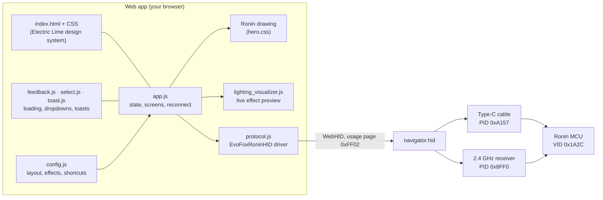

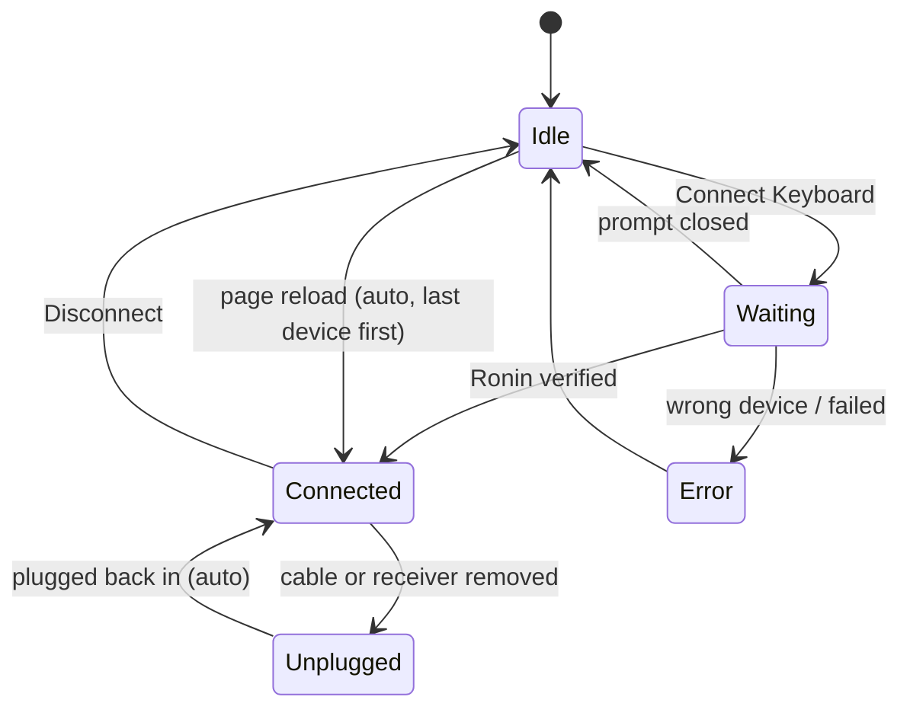

</details>

<details>
<summary><b>Protocol specification</b></summary>
<br>

**Device:** vendor `0x1A2C`, product `0xA157` (wired) or `0x8FF0` (2.4 GHz receiver), HID usage page `0xFF02`, usage `0x0002`.

**Report layout** (65 bytes):

```text
Byte 0      Report ID (0x00)
Byte 1..4   Header: 0xAA 0x55 0xCC 0x33
Byte 5      Command
Byte 6..64  Parameters
```

| Command | Hex | Parameters |
| :--- | :---: | :--- |
| Status and battery | `0x0E` | none; the reply carries battery, mode, charging, IDs and firmware |
| Lighting effect | `0x07` | B6 effect − 1, B7 brightness − 1, B8 speed − 1, B9 direction, B10 colour |
| Lighting off | `0x05` | B6 = 1 |
| Remap key | `0x04` | B6 layer + 1, B7 source key HID code, B8 target HID code |
| Per-key colour: start | `0x0B` | prepares the per-key buffer |
| Per-key colour: data | `0xF6`–`0xFB` | six 54-byte blocks of RGB |
| Per-key colour: save | `0x0A` | stores the colours on the keyboard |
| Sleep timer | `0x0C` | B6 1 = 2/30 min, 2 = 15/40 min, 3 = 30/60 min, 4 = never |
| Key response | `0x0D` | B6 1 = fastest (wired 2–3 ms), 2 = 4–5 ms, 3 = 6–7 ms |
| Fn layer mode | `0x10` | B6 0 = hold Fn, 1 = press once |
| Factory reset | `0x08` | none |
| Clear macros | `0x0F` | none |

**Status reply** (only replies with command byte `0x0E` are read as status, as in the official driver):

```javascript
const battery   = data[5];                                   // 0–100 %
const mode      = data[6] === 3 ? 'USB' : data[6] === 1 ? '2.4G' : 'keyboard not linked';
const charging  = data[7] === 1;
const vendorId  = (data[8] << 8) | data[9];                  // 0x1A2C
const productId = (data[10] << 8) | data[11];                // 0xA157 or 0x8FF0
const firmware  = `${data[12] >> 4}.${data[12] & 15}.${10 * (data[13] >> 4) + (data[13] & 15)}`;
```

</details>

<details>
<summary><b>Project structure</b></summary>
<br>

```text
evofox-ronin-configurator/
├── index.html                 App screens, dialogs and the welcome hero
├── manifest.json              Installable web app (PWA) manifest
├── server.js                  Zero-dependency local server (npm start)
├── wrangler.json              Cloudflare Workers static hosting
├── .assetsignore              Files left out of the deployment
├── assets/
│   ├── brand/                 Fox mark, app icon and logo lockups
│   ├── fonts/                 Geist + Geist Mono (bundled, no CDN)
│   ├── readme/                Screenshots and animations for this page
│   └── favicon, icons, og-banner
└── src/
    ├── app.js                 Screens, connection and reconnect logic, settings memory
    ├── protocol.js            EvoFoxRoninHID: WebHID driver with device checks
    ├── config.js              Key layout, effects, colours, shortcuts
    ├── lighting_visualizer.js Live effect preview (60 fps)
    ├── feedback.js / .css     Splash, spinners, busy buttons, card overlays, loader
    ├── select.js / .css       Branded dropdown (keeps the native <select> as data source)
    ├── toast.js / .css        Lime toasts with progress and undo
    ├── icons.js · ui.js       Icon set, dialogs, tooltips, undo shortcut
    ├── tokens.css             Design tokens (the only file with colour values)
    ├── fonts.css              Geist font faces
    ├── components.css         Buttons, inputs, switches, cards, dialogs
    ├── shell.css              Sidebar, header, device status, footer
    ├── brand.css              Lime brand layer: active states, signature shadows
    ├── pages.css · rgb.css    Page layouts (dashboard, RGB, remap, profiles, settings, guide)
    ├── callouts.css           Notices and tips
    ├── hero.css               The Ronin drawing: case, keycaps, knob, cable states
    ├── motion.css · backgrounds.css
    └── styles.css             Base layout
```

</details>

---

## FAQ

<details>
<summary><b>The page says “Receiver found • waking keyboard”. What now?</b></summary>
<br>
The 2.4 GHz receiver is plugged in, but the keyboard hasn't answered yet. Press any key to wake it. If it's in Bluetooth or wired mode, press <kbd>Fn</kbd> + <kbd>4</kbd>. The app keeps checking and connects as soon as the keyboard answers.
</details>

<details>
<summary><b>Do my settings stay when I close the browser?</b></summary>
<br>
Yes. Lighting, per-key colours, remaps and device settings are stored on the keyboard itself. The app also remembers your last settings and profiles in your browser, so they show up again next time.
</details>

<details>
<summary><b>Does it reconnect after a page reload?</b></summary>
<br>
Yes, to the cable or receiver you used last, without changing anything on the keyboard. If you fully close the browser, Chrome may ask you to pick the keyboard again; that's a browser permission rule.
</details>

<details>
<summary><b>Why is there no Underglow, Music Sync or polling-rate setting?</b></summary>
<br>
The Ronin has no side light strip and no adjustable polling rate, so those aren't offered. Music Sync needs Amkette's own Windows software.
</details>

<details>
<summary><b>Will it work on a different EvoFox keyboard?</b></summary>
<br>
No. It's built only for the Ronin 75% Wireless and refuses any other device, so it can't send the wrong commands to something else.
</details>

<details>
<summary><b>Mac, Linux, ChromeOS?</b></summary>
<br>
All work in Chrome or Edge. On Linux you may need a udev rule for vendor <code>1a2c</code> (see <a href="#quick-start">Quick start</a>).
</details>

---

<div align="center">

**Made with ❤️ by [Harsh Prajapati](https://www.instagram.com/harshprajapatiofficial/)**

Unofficial fan project, not affiliated with Amkette or EvoFox. EvoFox and Ronin are trademarks of their owners. Released under the [MIT License](LICENSE).

[Open the app](https://ronin.xaviermsd.workers.dev/) · [Report a bug](https://github.com/xaviermsd/evofox-ronin-configurator/issues)

</div>
